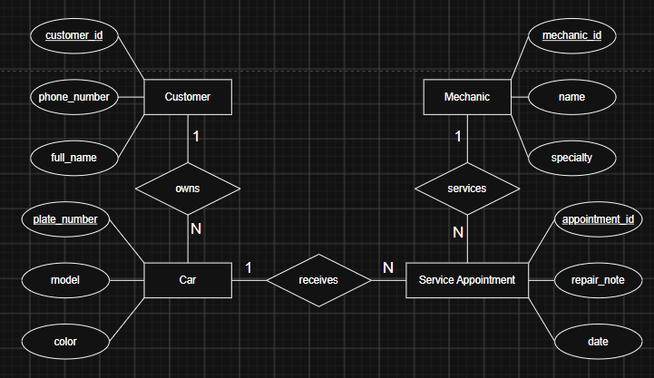

# INFOMAN1 – Week 2 Lab: Conceptual ERD Case Study
**Name:** Jhelianne Figuerres
**Student ID:** 2510465
**Section:** BSIT-II

## Task 1 — Candidate Entities

| Entity | Justification |
|---|---|
| Customer | The scenario explicitly states "The shop has many customers," establishing Customer as a distinct real-world candidate entity tracked by its own identity and actions, rather than a descriptive property of another entity. |
| Car | The phrase "each customer may bring in one or more cars" identifies Car as a core candidate entity that exists independently with its own attributes like model, plate number, and color. |
| Mechanic | The text "The shop employs several mechanics" specifies Mechanic as a distinct entity with unique properties like name and specialty. |
| Service Appointment | The text "a mechanic works on it during a scheduled service appointment" defines Service Appointment as a transactional entity possessing its own date and repair notes. |

## Task 2 — Attributes per Entity

### Customer
- Primary Key: customer_id
- Attributes:
  - customer_id — Domain: integer, unique identifier
  - full_name — Domain: text
  - phone_number — Domain: text (digits/hyphens)

### Car
- Primary Key: plate_number
- Attributes:
  - plate_number — Domain: alphanumeric text, unique registration
  - model — Domain: text 
  - color — Domain: text

### Mechanic
- Primary Key: mechanic_id
- Attributes:
  - mechanic_id — Domain: integer, unique identifier
  - name — Domain: text
  - specialty — Domain: text 
  
### Service Appointment
- Primary Key: appointment_id
- Attributes:
  - appointment_id — Domain: integer, unique identifier
  - appointment_date — Domain: date (YYYY-MM-DD)
  - repair_note — Domain: short text / string

## Task 3 — Relationships

| Relationship (verb phrase) | Between | Cardinality | Checked both directions? |
|---|---|---|---|
| owns | Customer ↔ Car | 1:N | Yes — Direction 1: One Customer may bring in one or more Cars (1 to N). Direction 2: Each Car belongs to exactly one Customer (N to 1). Result: 1:N cardinality. |
| services | Mechanic ↔ Service Appointment | 1:N | Yes — Direction 1: One Mechanic may work on many Service Appointments over time (1 to N). Direction 2: Each Service Appointment has one Mechanic assigned (N to 1). Result: 1:N cardinality. |
| receives | Car ↔ Service Appointment | 1:N | Yes — Direction 1: One Car may be serviced during multiple Service Appointments over time (1 to N). Direction 2: Each Service Appointment is scheduled for exactly one specific Car (N to 1). Result: 1:N cardinality. |

## Task 4 — Conceptual ERD

